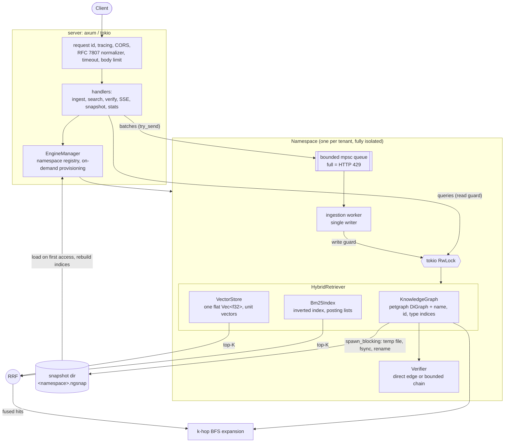

# NexusGraph

A hybrid vector + knowledge-graph retrieval engine with deterministic claim
verification, written in Rust.

NexusGraph targets one failure mode of retrieval-augmented generation:
multi-hop questions. A flat top-K search returns passages that *look like* the
question; the fact that answers it is often two relations away and looks like
nothing in the question. NexusGraph retrieves entities with dense vectors and
BM25, fuses the two rankings, expands the result through an explicit knowledge
graph, and then checks the relations an LLM claims against that same graph,
returning either the supporting path or the exact hop that is missing.

- **Hybrid retrieval**: exact cosine k-NN (NEON / AVX2+FMA / scalar) and BM25,
  merged with Reciprocal Rank Fusion, expanded k hops through the graph.
- **Deterministic verification**: every claim `source -relation-> target` is
  verified by a direct edge or a bounded same-relation chain, or rejected with
  a reason and a broken-path trace. Same graph and claims, same report.
- **Multi-tenant HTTP service**: isolated namespaces, back-pressured ingestion,
  Server-Sent Events, atomic snapshots, RFC 7807 errors.
- **No `unsafe` outside one audited SIMD file**; no `unwrap`, `expect`, `panic!`
  or slice indexing in `src/` (enforced by lints).

## Contents

1. [Quick start](#quick-start)
2. [Architecture](#architecture)
3. [Memory model and trade-offs](#memory-model-and-trade-offs)
4. [Benchmarks](#benchmarks)
5. [Retrieval evaluation](#retrieval-evaluation)
6. [HTTP API](#http-api)
7. [Deployment](#deployment)
8. [Command line](#command-line)
9. [Development](#development)
10. [Limitations](#limitations)

## Quick start

```sh
cargo build --release

# Serve on localhost, one snapshot file per namespace under ./data
./target/release/nexus_graph serve --bind 127.0.0.1:8080 --snapshot-dir ./data

# ...or with Docker (non-root, read-only root filesystem, named volume)
docker compose up --build
```

Then follow the [cURL walkthrough](#curl-walkthrough). Requires Rust 1.80 or
newer.

## Architecture



### Modules

| Module | Responsibility |
|---|---|
| `models` | `EntityNode`, `RelationEdge`, `GraphClaim`: the JSON and bincode schema contracts. |
| `graph` | `KnowledgeGraph`: `petgraph::DiGraph` behind a `parking_lot::RwLock`, with name / id / type indices, k-hop BFS and path enumeration. Append-only, so node indices are stable. |
| `verifier` | `verify_claims`: deterministic verdicts, evidence paths, rejection reasons, broken-path traces, confidence score. |
| `storage` | Checksummed binary snapshots written with temp file + fsync + atomic rename. |
| `vector` | `simd.rs` (the only `unsafe` in the crate): dot and cosine kernels. `store.rs`: contiguous vector store with bounded-heap top-K. |
| `lexical` | Unicode-normalizing tokenizer and BM25 inverted index. |
| `retrieval` | Reciprocal Rank Fusion and the `HybridRetriever` orchestrator. |
| `server` | axum router, namespace registry, ingestion queues, SSE, RFC 7807 errors. |
| `eval` | Recall@K, MRR, coverage and path-recovery metrics; the differential evaluation runner. |

### Query path

1. The handler validates the request and awaits a **shared** engine lock.
2. The owned guard moves into `spawn_blocking`; nothing below runs on a Tokio
   worker thread.
3. The query embedding is normalized once; the vector store scans every row
   with one dot product each, keeping the best K in a bounded min-heap.
4. BM25 scores the documents on the posting lists of the query's distinct
   terms.
5. RRF merges the two rankings: `score(d) = sum over channels of w / (k + rank(d))`,
   `k = 60`. Only ranks are used, so cosine similarities and BM25 scores never
   need calibrating against each other.
6. The fused top-K seed a breadth-first expansion (both edge directions); the
   response is the hits plus the induced subgraph around them.

### Write path

Every batch is handed to the namespace's bounded queue with `try_send`. A full
queue is answered immediately with `429` and `Retry-After`; nothing buffers
without bound. One worker per namespace applies batches in arrival order under
the **exclusive** engine lock, on the blocking pool, so a namespace's graph and
indices never observe a half-applied batch.

### Verification contract

A claim `S -R-> T` is **verified** when

1. the edge `S -R-> T` exists (*direct*), or
2. `R` is transitive (`DependsOn`, `Contains`, `Supersedes`) and a chain of at
   most `max_hops` edges, all of type `R`, leads from `S` to `T`
   (*transitive*); the highest-confidence chain is reported.

Otherwise it is **rejected** with one of `UnknownEntity`, `RelationMismatch`,
`DirectionReversed`, `DepthExceeded`, `NoSupportingPath`, and a trace such as

```text
auth-service -[DependsOn]-> postgres -[DependsOn]-> object-storage -[DependsOn]-x-> billing-service
```

A verified claim scores the product of its edge weights, a rejected one zero;
the report's confidence score is the mean.

## Memory model and trade-offs

### Flat contiguous vectors

All vectors of a namespace live back to back in **one `Vec<f32>`**: row `i` is
`data[i * dim .. (i + 1) * dim]`. The alternative, a `Vec<Vec<f32>>` or vectors
stored inside graph nodes, costs one pointer dereference and a potential cache
and TLB miss per candidate, and scatters rows across the heap. With the flat
layout a scan is a single forward walk that the hardware prefetcher follows
exactly, and a search touches no memory other than the buffer, the id array and
a K-element heap.

Vectors are **L2-normalized at insertion** (original magnitudes are kept in a
parallel array), which turns cosine similarity into one dot product per row and
removes two of the three sums from the hot loop.

Measured footprint (`examples/memory_footprint.rs`, release build, macOS
`/usr/bin/time -l`):

| Store | Raw payload | Store heap (accounted) | Process peak RSS |
|---|---|---|---|
| 100,000 x 384 | 146.5 MiB | 149.5 MiB | 155.0 MiB |
| 100,000 x 768 | 293.0 MiB | 296.0 MiB | 301.5 MiB |
| 10,000 x 1536 | 58.6 MiB | 58.9 MiB | 61.2 MiB |

Overhead beyond the raw floats is about 32 bytes per vector (norm, id, id-to-row
map entry). The peak RSS is this low because `bulk_load` into an empty store
*adopts* the caller's buffer and normalizes it in place instead of copying it.

### Cache alignment

The buffer comes from the global allocator and is **not** over-aligned to 64
bytes; kernels use unaligned loads. The alignment benchmark below measures what
that costs on this machine: nothing distinguishable (31.6 ns vs 31.9 ns for a
768-dimensional NEON dot product at a cache-line boundary vs 4 bytes past one).
Aligned storage would need a custom allocation and `unsafe` outside the SIMD
module, and was not worth that here. It may matter more on x86 with 32-byte
loads, where every second load would split a line; that has not been measured
on real hardware (see [Limitations](#limitations)).

### Pointer graph next to flat vectors

The graph is the opposite shape on purpose. Traversal is inherently
pointer-chasing (follow an edge, land somewhere unrelated), and `petgraph`'s
adjacency lists in two index-addressed arrays are a reasonable representation
for it. The two structures meet only through entity ids, so each keeps the
layout that suits its access pattern:

| | Vector store | Knowledge graph |
|---|---|---|
| Access pattern | Sequential scan of everything | Random walks from a few seeds |
| Layout | One contiguous buffer | Node and edge arrays, intrusive adjacency lists |
| Cost model | `O(N * dim)`, memory-bandwidth bound | `O(edges visited)`, cache-miss bound |
| Measured | 2.0 ms for 100,000 x 384 | 81 us for a 491-node 3-hop subgraph |

### Other decisions

| Decision | Why | Cost |
|---|---|---|
| Exact scan, no ANN index | Deterministic results, no recall loss, no index build or tuning. | Latency is linear in corpus size: about 20 ns per 384-dimensional row. |
| Embeddings stored in the graph *and* the store | The snapshot holds the graph only; indices are rebuilt from it on load and can never disagree with it. | Embeddings are held twice in memory. |
| One `RwLock` per namespace, single writer | Readers never see a partial batch; writes are totally ordered. | A long batch delays that namespace's queries (and `/stats`) until it finishes. |
| Append-only graph | Stable node indices across the process lifetime and snapshot roundtrips. | No delete or rename of entities. |
| RRF over score blending | No calibration between cosine and BM25 scales; robust to either channel returning nothing. | Ignores score margins; see the `lexical` row of the evaluation, where it loses to BM25 alone. |
| Validation by result | A finite dot product proves finite inputs, so the checked entry points make one pass over the data, not two. | Which input was bad is only determined on the failure path. |

## Benchmarks

All numbers were measured on one machine and are **not** portable:

- Apple M5 (4 performance + 6 efficiency cores), 16 GB, macOS 26.5
- rustc 1.99.1, `--release` (`lto = "thin"`, `codegen-units = 1`), active kernel: NEON
- Criterion 0.7: 1 s warm-up, 3 s measurement, 60 samples (30 for the largest
  scan), outliers classified by Tukey's fences. The value shown is Criterion's
  point estimate; its 95% confidence interval was within about 1.5% of it for
  every row.

```sh
cargo bench                       # everything (about 8 minutes)
cargo bench --bench bench_simd    # one suite
cargo bench -- vector_scan        # filter by name
```

Criterion reports a central estimate, not tail latency. Each suite therefore
also times every individual call of the query-level operations and prints
p50 / p95 / p99 (the `latency ...` lines).

### SIMD kernels (`bench_simd`)

Time per call, and elements per second in parentheses.

| Operation | Dimension | Scalar | NEON | NEON speed-up |
|---|---|---|---|---|
| dot | 384 | 22.0 ns (17.5 G/s) | 17.8 ns (21.6 G/s) | 1.23x |
| dot | 768 | 47.2 ns (16.3 G/s) | 35.2 ns (21.8 G/s) | 1.34x |
| dot | 1536 | 106.8 ns (14.4 G/s) | 67.5 ns (22.7 G/s) | 1.58x |
| cosine | 384 | 39.3 ns (9.8 G/s) | 26.5 ns (14.5 G/s) | 1.48x |
| cosine | 768 | 73.0 ns (10.5 G/s) | 48.8 ns (15.8 G/s) | 1.50x |
| cosine | 1536 | 140.4 ns (10.9 G/s) | 92.5 ns (16.6 G/s) | 1.52x |

Reading these honestly:

- The speed-up over "scalar" is modest because the scalar fallback is written
  with eight independent accumulators and LLVM auto-vectorizes it. It is the
  portable baseline, not a naive loop.
- **The AVX2+FMA kernel has no numbers here.** It is compiled, linted and
  tested for correctness on `x86_64` (under Rosetta 2 with AVX2 enabled), but
  emulated timings say nothing about real Intel or AMD hardware. Run
  `cargo bench --bench bench_simd` on an x86 machine to get them.

| Variant (768 dimensions, NEON) | Time |
|---|---|
| dot, operands on a cache-line boundary | 31.6 ns |
| dot, operands 4 bytes past a boundary | 31.9 ns |
| dot, raw kernel | 35.5 ns |
| dot, checked (`dot_product`) | 33.0 ns |
| cosine, raw kernel | 48.6 ns |
| cosine, checked (`cosine_similarity`) | 54.9 ns |

The checked entry points cost the same as the raw kernels to within noise for
dot, and 13% more for cosine.

### Retrieval (`bench_retrieval`)

Exact top-10 cosine search:

| Rows x dimension | Mean | p50 | p95 | p99 | Rows / s |
|---|---|---|---|---|---|
| 1,000 x 384 | 18.2 us | | | | 55.0 M |
| 10,000 x 384 | 176.5 us | 182.2 us | 187.7 us | 199.7 us | 56.7 M |
| 100,000 x 384 | 2.02 ms | 2.04 ms | 2.07 ms | 2.15 ms | 49.6 M |
| 10,000 x 768 | 364.0 us | | | | 27.5 M |
| 10,000 x 1536 | 768.6 us | | | | 13.0 M |

The scan is linear in both rows and dimension. Per-row cost at 384 dimensions
(17.7 ns at 10,000 rows) equals the bare kernel time, i.e. the top-K heap and
iteration add nothing measurable; at 100,000 rows (154 MB, beyond the caches)
it rises to 20.2 ns.

BM25, three-term query (one common, one mid-frequency, one rare term), 40-token
documents drawn from a 20,000-word Zipf vocabulary:

| Documents | Mean | p50 | p95 | p99 |
|---|---|---|---|---|
| 1,000 | 17.7 us | | | |
| 10,000 | 144.5 us | | | |
| 100,000 | 1.98 ms | 2.00 ms | 2.03 ms | 2.04 ms |

This query is close to a worst case: its common term occurs in most documents,
so the posting list is nearly the whole corpus. Cost follows posting-list
length, not corpus size.

Reciprocal Rank Fusion:

| Channels x list length | Mean |
|---|---|
| 2 x 10 | 0.72 us |
| 2 x 100 | 6.99 us |
| 2 x 1,000 | 68.0 us |
| 4 x 10 | 0.99 us |
| 4 x 100 | 10.0 us |
| 4 x 1,000 | 122.9 us |

End-to-end hybrid query (10,000 entities, 384 dimensions, text + vector,
top-10, about four relations per entity):

| Expansion | Mean | p50 | p95 | p99 |
|---|---|---|---|---|
| 0 hops | 321.1 us | | | |
| 1 hop | 326.5 us | 332.9 us | 344.2 us | 355.8 us |
| 2 hops | 351.4 us | | | |

Graph expansion adds 5 us (1 hop) to 30 us (2 hops) to a query dominated by the
two index scans.

### Graph and verification (`bench_verifier`)

k-hop BFS on 50,000 nodes with four random out-edges each (about eight
neighbours counting both directions):

| k | Subgraph size (mean) | Mean | p50 | p95 | p99 |
|---|---|---|---|---|---|
| 1 | 8 nodes | 1.08 us | 1.46 us | 2.21 us | 2.58 us |
| 2 | 66 nodes | 9.46 us | 10.6 us | 16.6 us | 19.8 us |
| 3 | 491 nodes | 81.3 us | 85.6 us | 130.2 us | 158.6 us |

Cost is proportional to the size of the returned subgraph (about 165 ns per
node, which includes cloning each entity into the result).

Claim verification, 64 claims against a complete dependency tree of depth 3
(`max_hops = 3`), per branching factor:

| Branching | Nodes | Verified, 3-hop chain | Rejected, unreachable target |
|---|---|---|---|
| 2 | 15 | 60.9 us (0.95 us / claim) | 102.5 us (1.6 us / claim) |
| 4 | 85 | 273.1 us (4.3 us / claim) | 470.9 us (7.4 us / claim) |
| 8 | 585 | 1.99 ms (31 us / claim) | 3.54 ms (55 us / claim) |
| 16 | 4,369 | 15.5 ms (242 us / claim) | 27.5 ms (430 us / claim) |

Single-claim latency: p50 4.2 us / p99 5.1 us at branching 4, p50 249 us /
p99 265 us at branching 16.

This is the engine's weakest scaling behaviour and worth knowing: a multi-hop
check explores the **whole** same-relation neighbourhood of the claim's source
within `max_hops` (to find the highest-confidence chain), so its cost tracks
the size of that neighbourhood, about 55 ns per node here, not the length of
the path it finds. Direct claims do not pay this: 1,000 direct claims on the
50,000-node graph verify in 262.6 us (0.26 us each).

### Concurrent HTTP (`bench_http`)

Requests go to the router in-process (no sockets) on a multi-threaded Tokio
runtime: the figures include routing, middleware, JSON, lock acquisition and
the `spawn_blocking` hop, and exclude the network. Closed-loop clients, 4,000
requests per row. Namespace: 5,000 entities, 128 dimensions.

| Endpoint | Clients | p50 | p95 | p99 | Throughput |
|---|---|---|---|---|---|
| `POST search/hybrid` (1 hop) | 1 | 238 us | 272 us | 286 us | 4,119 req/s |
| | 8 | 302 us | 586 us | 598 us | 20,542 req/s |
| | 32 | 1.05 ms | 3.75 ms | 8.51 ms | 21,341 req/s |
| `POST verify` (16 direct claims) | 1 | 43 us | 47 us | 51 us | 23,263 req/s |
| | 8 | 116 us | 162 us | 186 us | 69,027 req/s |
| | 32 | 317 us | 1.27 ms | 2.30 ms | 67,962 req/s |

Throughput saturates between 8 and 32 clients on this 10-core machine; past
that point additional clients only queue, which is what the p99 at 32 clients
shows. `GET /healthz` alone takes 9.2 us per request, the floor set by the
middleware stack.

## Retrieval evaluation

```sh
nexus_graph eval --dataset examples/eval_dataset.json            # 1-hop expansion
nexus_graph eval --dataset examples/eval_dataset.json --hops 2 --json
```

The evaluator runs every query through four configurations of the same engine
and scores them against ground truth:

| Row | Channels | Returned context |
|---|---|---|
| Vector only | dense k-NN | the top-K hits |
| BM25 only | lexical | the top-K hits |
| Hybrid RRF (no expansion) | both, fused | the top-K hits |
| NexusGraph hybrid (RRF + graph) | both, fused | the top-K hits + k-hop expansion |

| Metric | Definition |
|---|---|
| MRR | Mean of `1 / rank` of the first relevant entity among the hits. |
| R@5, R@10 | Mean fraction of relevant entities in the top 5 / 10 hits. |
| ans@ctx | Mean fraction of relevant entities anywhere in the returned context. |
| coverage | Context Coverage Score: mean fraction of ground-truth evidence entities (the reasoning chain) in the context. |
| path | Path recovery: fraction of multi-hop queries whose **every** evidence hop is an edge of the context. |
| ctx | Mean number of entities in the context: what the coverage costs. |

**Graph expansion adds context; it does not rerank.** The two hybrid rows
therefore have identical MRR and Recall@K by construction. What expansion buys
appears in the last four columns, next to its price in context size.

### The example dataset is synthetic

`examples/eval_dataset.json` (168 entities, 226 relations, 70 queries) is
generated by `examples/generate_eval_dataset.py`. There is no real corpus and
no real embedding model behind it: embeddings are random topic directions plus
noise. Its three query classes are *constructed* to isolate one behaviour each:

- `lexical`: the query names an opaque identifier; the embedding only says
  "some datastore".
- `semantic`: the query paraphrases a team's remit in words that occur in no
  description; the embedding points at the right topic.
- `multi_hop_1`, `multi_hop_2`: the query names a service and asks for
  something one or two relations away that shares neither vocabulary nor topic
  with it.

**So the results below show how the modes differ and that the harness works.
They are not evidence of how much a real deployment would gain.** For that, run
the evaluator on your own graph, queries and embeddings; the dataset format is
documented in `src/eval/mod.rs`.

### Results (`top_k = 10`, 1-hop expansion)

```text
all queries (n=70)
system                              MRR    R@5   R@10  ans@ctx  coverage   path    ctx
Vector only                       0.324  0.343  0.471    0.471     0.633  0.233   10.0
BM25 only                         0.286  0.286  0.286    0.286     0.464  0.000    7.3
Hybrid RRF (no expansion)         0.406  0.443  0.614    0.614     0.793  0.200   10.0
NexusGraph hybrid (RRF + graph)   0.406  0.443  0.614    0.871     0.929  0.800   25.5

category: lexical (n=20)
Vector only                       0.089  0.200  0.300    0.300     0.300    n/a   10.0
BM25 only                         1.000  1.000  1.000    1.000     1.000    n/a   10.0
Hybrid RRF (no expansion)         0.409  0.550  0.850    0.850     0.850    n/a   10.0
NexusGraph hybrid (RRF + graph)   0.409  0.550  0.850    0.850     0.850    n/a   31.7

category: multi_hop_1 (n=15)
Vector only                       0.058  0.000  0.467    0.467     0.733  0.467   10.0
BM25 only                         0.000  0.000  0.000    0.000     0.500  0.000   10.0
Hybrid RRF (no expansion)         0.047  0.000  0.400    0.400     0.700  0.400   10.0
NexusGraph hybrid (RRF + graph)   0.047  0.000  0.400    1.000     1.000  1.000   24.7

category: multi_hop_2 (n=15)
Vector only                       0.000  0.000  0.000    0.000     0.489  0.000   10.0
BM25 only                         0.000  0.000  0.000    0.000     0.333  0.000   10.0
Hybrid RRF (no expansion)         0.000  0.000  0.000    0.000     0.533  0.000   10.0
NexusGraph hybrid (RRF + graph)   0.000  0.000  0.000    0.600     0.867  0.600   23.3

category: semantic (n=20)
Vector only                       1.000  1.000  1.000    1.000     1.000    n/a   10.0
BM25 only                         0.000  0.000  0.000    0.000     0.000    n/a    0.4
Hybrid RRF (no expansion)         0.975  1.000  1.000    1.000     1.000    n/a   10.0
NexusGraph hybrid (RRF + graph)   0.975  1.000  1.000    1.000     1.000    n/a   21.5
```

What this shows, including where the hybrid is *not* better:

- **Fusion is more robust, not uniformly best.** Overall Recall@10 rises from
  0.471 (vector) and 0.286 (BM25) to 0.614. But on `lexical` queries
  equal-weight RRF *dilutes* a perfect BM25 ranking (MRR 1.000 to 0.409),
  because entities that are mediocre in both channels outrank one that is first
  in a single channel. Raising `--lexical-weight` trades this against the
  `semantic` class.
- **Ranking cannot reach multi-hop answers.** No flat system puts a 2-hop
  answer in its top 10 (Recall@10 = 0.000 in all three), and expansion does not
  change that column either.
- **Expansion recovers the evidence.** With one hop, the full evidence chain is
  in the context for 100% of 1-hop and 60% of 2-hop questions (from 40% and 0%),
  and overall path recovery goes from 0.200 to 0.800.
- **It costs context.** The context grows from 10 to 25.5 entities on average.
  With `--hops 2`, path recovery reaches 1.000 and ans@ctx 0.986, at 55.2
  entities, a third of this small graph. A comparison at equal context size is
  not part of this harness.

## HTTP API

Base path: `/v1/namespaces/{namespace_id}`. A namespace id is 1 to 64
characters of `[A-Za-z0-9_-]`, not starting with `-`. Namespaces are created by
their first write and loaded from the snapshot directory on first access;
reading one that exists nowhere is a `404`.

| Method | Path | Purpose | Success |
|---|---|---|---|
| POST | `/entities/batch` | Queue a batch of entities | `200` report, or `202` with `?wait=false` |
| POST | `/relations/batch` | Queue a batch of relations | same |
| POST | `/search/hybrid` | Fused hits + graph context | `200` |
| POST | `/verify` | Verify claims, full report | `200` |
| GET | `/verify/stream?claims=<json>` | Verify claims, SSE | `200` event stream |
| POST | `/verify/stream` | Same, claims in the body | `200` event stream |
| POST | `/snapshot` | Persist the namespace | `202`, or `200` with `?wait=true` |
| GET | `/stats` | Sizes, queue and snapshot state | `200` |
| GET | `/healthz` (root) | Liveness | `200` |
| GET | `/metrics` (root) | Prometheus text metrics | `200` |

### cURL walkthrough

```sh
B=http://127.0.0.1:8080
NS=$B/v1/namespaces/demo
```

**Batch ingestion.** Items are applied independently and in order; a rejected
item is reported and does not stop the rest. The status is `200` even when some
items were rejected, so check `rejected`.

```sh
curl -s -X POST $NS/entities/batch -H 'content-type: application/json' -d '{
  "entities": [
    {"name": "billing-service", "type": "Service",
     "attributes": {"description": "Generates invoices and charges credit cards"},
     "embedding": [0.9, 0.1, 0.2, 0.1]},
    {"name": "auth-service", "type": "Service",
     "attributes": {"description": "Issues login tokens and validates sessions"},
     "embedding": [0.1, 0.9, 0.1, 0.1]},
    {"name": "postgres", "type": "Service",
     "attributes": {"description": "Relational database storing accounts"},
     "embedding": [0.3, 0.4, 0.8, 0.1]},
    {"name": "on-call rotation", "type": {"Custom": "Process"}}
  ]}'
# {"ingested":4,"rejected":[]}

curl -s -X POST $NS/relations/batch -H 'content-type: application/json' -d '{
  "relations": [
    {"source": "billing-service", "target": "auth-service", "relation": "DependsOn", "weight": 0.9},
    {"source": "auth-service", "target": "postgres", "relation": "DependsOn", "weight": 0.8}
  ]}'
# {"ingested":2,"rejected":[]}
```

Entity types: `Organization`, `Concept`, `Service`, `Artifact`,
`{"Custom": "..."}`. Relation types: `DependsOn`, `ProducedBy`, `Supersedes`,
`Contains`, `{"Custom": "..."}`. `weight` is a confidence in `[0, 1]`
(default 1). Re-sending a relation updates its weight; re-sending an entity
name is rejected. All embeddings in a namespace must share one dimension.

With `?wait=false` the response is `202 {"status":"queued","pending_jobs":n}`
as soon as the batch is queued. When the queue is full, either mode returns:

```http
HTTP/1.1 429 Too Many Requests
content-type: application/problem+json
retry-after: 1

{"type":"urn:nexus-graph:problem:ingest-backpressure","title":"Ingestion Queue Full",
 "status":429,"detail":"the ingestion queue of this namespace is full (64 jobs); retry later",
 "queue_capacity":64,"retry_after_seconds":1}
```

**Hybrid query.** At least one of `text` and `embedding`; the other fields
override server defaults.

```sh
curl -s -X POST $NS/search/hybrid -H 'content-type: application/json' -d '{
  "text": "login tokens",
  "embedding": [0.0, 1.0, 0.0, 0.0],
  "top_k": 2,
  "expansion_hops": 1
}'
```

```json
{
  "hits": [
    {"id": 1, "name": "auth-service", "entity_type": "Service", "fused_score": 0.03278688524590164,
     "vector": {"rank": 1, "score": 0.9819805026054382},
     "lexical": {"rank": 1, "score": 2.1604732214657907}},
    {"id": 2, "name": "postgres", "entity_type": "Service", "fused_score": 0.016129032258064516,
     "vector": {"rank": 2, "score": 0.42163702845573425},
     "lexical": null}
  ],
  "context": {
    "nodes": [
      {"entity": {"id": 1, "canonical_name": "auth-service", "entity_type": "Service",
                  "attributes": {"description": "Issues login tokens and validates sessions"},
                  "embedding": null}, "depth": 0},
      {"entity": {"id": 2, "canonical_name": "postgres", "...": "..."}, "depth": 0},
      {"entity": {"id": 0, "canonical_name": "billing-service", "...": "..."}, "depth": 1}
    ],
    "edges": [
      {"source": 0, "target": 1, "relation": "DependsOn", "weight": 0.9, "metadata": {}},
      {"source": 1, "target": 2, "relation": "DependsOn", "weight": 0.8, "metadata": {}}
    ]
  }
}
```

`auth-service` is first in both channels (`2 / 61`); `postgres` is ranked by the
vector channel only; `billing-service` was not a hit and arrives through the
graph at depth 1. Optional fields: `candidate_pool`, `rrf_k`,
`vector_weight`, `lexical_weight` (a weight of 0 disables that channel) and
`include_embeddings` (context embeddings are omitted unless set).

**Verification, one response.**

```sh
curl -s -X POST $NS/verify -H 'content-type: application/json' -d '{
  "max_hops": 3,
  "claims": [
    {"source_entity": "billing-service", "target_entity": "postgres", "relation": "DependsOn",
     "citation": {"document_id": "architecture.md", "chunk_id": "c-04"}},
    {"source_entity": "postgres", "target_entity": "billing-service", "relation": "DependsOn",
     "citation": {"document_id": "architecture.md", "chunk_id": "c-09"}}
  ]}'
# {"total_claims":2,
#  "verified":[{"claim_index":0,...,"evidence":"Transitive","path":{"hops":[...]},"confidence":0.71999997}],
#  "hallucinated":[{"claim_index":1,...,"reason":"NoSupportingPath",
#    "trace":{"reached":{"hops":[]},"missing_hop":{"from":"postgres","relation":"DependsOn","to":"billing-service"}}}],
#  "confidence_score":0.35999998}
```

**Verification, SSE stream.** One event per claim, in submission order, as each
is checked, then one terminal `complete` event (or `error`, carrying a problem
document, if verification fails mid-stream).

```sh
curl -s -N -G $NS/verify/stream --data-urlencode 'claims=[
  {"source_entity": "billing-service", "target_entity": "postgres", "relation": "DependsOn",
   "citation": {"document_id": "architecture.md", "chunk_id": "c-04"}},
  {"source_entity": "postgres", "target_entity": "billing-service", "relation": "DependsOn",
   "citation": {"document_id": "architecture.md", "chunk_id": "c-09"}}]'
```

```text
event: claim_verified
data: {"claim_index":0,"claim":{...},"evidence":"Transitive","path":{...},"confidence":0.71999997}

event: claim_rejected
data: {"claim_index":1,"claim":{...},"reason":"NoSupportingPath","trace":{...}}

event: complete
data: {"total_claims":2,"verified":1,"rejected":1,"confidence_score":0.35999998}
```

For claim lists too long for a URL, `POST $NS/verify/stream` takes the same
body as `/verify`. The stream holds no lock, so a slow consumer cannot stall
ingestion; each claim is checked against the graph as it is at that moment,
whereas `/verify` checks the whole batch against one state.

**Snapshot and recovery.**

```sh
# Background (default): 202 now, outcome under "snapshot" in /stats
curl -s -X POST $NS/snapshot
# {"namespace":"demo","status":"scheduled"}

# Synchronous: 200 once <snapshot-dir>/demo.ngsnap is on disk
curl -s -X POST "$NS/snapshot?wait=true"
# {"completed_at_unix_ms":1794434514007,"duration_ms":8,"bytes":568}

curl -s $NS/stats
# {"namespace":"demo","entities":4,"relations":2,"vectors":3,"vector_dim":4,"terms":21,"documents":4,
#  "ingest":{"queue_capacity":64,"queued_jobs":0,"pending_jobs":0,"accepted_jobs":2,...},
#  "snapshot":{"pending":0,"last_success":{...},"last_error":null}}
```

Recovery needs no call: after a restart, the first request that touches `demo`
loads `demo.ngsnap`, rebuilds the vector and BM25 indices from it, and
proceeds. Only snapshotted state survives; **there is no write-ahead log and no
snapshot on shutdown**, so snapshot after the writes you need to keep. A
snapshot that fails its checksum is a `500`, never a silently empty namespace.

### Errors

Every 4xx and 5xx is `application/problem+json` (RFC 7807) with `type`,
`title`, `status`, `detail`, and an `x-request-id` response header to quote
when reporting it.

| Status | When |
|---|---|
| 400 | Malformed JSON or query string; invalid namespace id |
| 404 | Unknown route; namespace that exists neither in memory nor on disk |
| 405 | Wrong method |
| 413 | Body over 32 MiB; more than 10,000 batch items or claims |
| 415 | Body without `content-type: application/json` |
| 422 | Well-formed but invalid: unknown field, wrong embedding dimension, zero vector, no query input, limits on `top_k` / hops |
| 429 | Ingestion queue full (`Retry-After` set) |
| 500 | Corrupted snapshot, internal failure |
| 504 | No response within the request timeout (30 s). A timed-out ingest was already accepted and is still applied. |
| 507 | The server already holds its maximum number of namespaces (1,024) |

## Deployment

```sh
docker compose up --build -d
docker compose ps          # STATUS shows (healthy)
```

`Dockerfile` is a two-stage build:

- **Build**: `rust:1-slim-bookworm`, `cargo build --release --locked`, BuildKit
  cache mounts for the registry and `target/`, symbols stripped.
- **Runtime**: `gcr.io/distroless/cc-debian12:nonroot` (glibc, no shell, no
  package manager), running as UID/GID 10001. `/data` is the only writable
  path. The health check is the binary probing itself
  (`nexus_graph healthcheck`), since the image has no curl.

`docker-compose.yml` adds what an image cannot declare for itself: a read-only
root filesystem, `cap_drop: [ALL]`, `no-new-privileges`, a named volume for
`/data`, and a port published on **loopback only** (`127.0.0.1:8080`).

The equivalent `docker run`:

```sh
docker run -d --name nexus-graph \
  --read-only --cap-drop ALL --security-opt no-new-privileges:true \
  --user 10001:10001 -v nexus-snapshots:/data -p 127.0.0.1:8080:8080 \
  nexus_graph:local
```

Operational notes:

- **There is no authentication or authorization.** Anyone who can reach the
  port can read and write any namespace by id. Keep it on a private network or
  behind a gateway that authenticates and maps callers to namespaces.
- `SIGTERM` and `SIGINT` stop accepting connections and let in-flight requests
  finish. They do not snapshot.
- Size memory for the vectors twice (graph + index) plus text; see
  [Memory model](#memory-model-and-trade-offs).
- `/metrics` exposes per-namespace gauges and counters (`nexus_graph_entities`,
  `nexus_graph_ingest_pending_jobs`, `nexus_graph_ingest_rejected_jobs_total`,
  ...). A rising rejected-jobs counter means writers are outpacing ingestion.

## Command line

```text
nexus_graph ingest <graph.json> <snapshot>          Build a snapshot from a JSON graph
nexus_graph stats <snapshot>                        Entity and relation counts
nexus_graph verify <snapshot> <claims.json> [hops]  Verify claims (exit status 2 if any is rejected)
nexus_graph index <snapshot>                        Build the indices, print their statistics
nexus_graph search <snapshot> <query> [top_k]       BM25 text search
nexus_graph hybrid <snapshot> [--text q] [--vector f,f,..] [--like entity] [--top-k n] [--hops n] [--json]
nexus_graph serve --bind <addr> --snapshot-dir <path> [--queue-capacity n] [--timeout-secs n] [--cors-origin o]
nexus_graph eval --dataset <path> [--top-k n] [--hops n] [--json]
nexus_graph healthcheck [addr]
```

```sh
nexus_graph ingest examples/hybrid_graph.json /tmp/demo.ngsnap
nexus_graph hybrid /tmp/demo.ngsnap --text "login tokens" --like auth-service --top-k 3
nexus_graph verify /tmp/demo.ngsnap examples/claims.json
```

## Development

```sh
cargo test                                  # 64 tests
cargo clippy --all-targets -- -D warnings   # pedantic; unwrap/expect/panic/indexing denied
cargo fmt --check
cargo bench --no-run                        # compile the benchmarks
```

| Suite | Covers |
|---|---|
| `tests/test_graph_and_verifier.rs` | Graph invariants, BFS coverage, verification verdicts and traces, snapshot integrity, concurrent readers and writers |
| `tests/test_phase2_retrieval.rs` | SIMD vs scalar agreement at every length, cosine correctness, vector store, tokenizer, BM25 formula, RRF, end-to-end retrieval |
| `tests/test_phase3_api.rs` | The HTTP API in-process: namespace isolation, backpressure, SSE order and format, snapshot reload, the error contract |
| `tests/test_phase4_eval.rs` | Metric definitions, a hand-computed evaluation, dataset validation, the example dataset |
| `src/vector/simd.rs` (unit) | Kernel bounds on mismatched lengths, NaN/Inf propagation |

The dependency lockfile is resolved to versions that build on Rust 1.80. To
exercise the AVX2 path on Apple Silicon:

```sh
rustup target add x86_64-apple-darwin
ROSETTA_ADVERTISE_AVX=1 cargo test --target x86_64-apple-darwin
```

## Limitations

- **Exact search only.** There is no approximate index; query latency grows
  linearly with the number of vectors (about 2 ms per 100,000 at 384
  dimensions on the test machine).
- **AVX2 is unbenchmarked on real x86 hardware**, and exercised for
  correctness only under emulation.
- **Durability is snapshot-only.** Writes since the last snapshot are lost on a
  crash or restart.
- **No authentication, no per-tenant quotas** beyond the queue and the
  namespace cap. Namespaces are never evicted from memory.
- **Append-only graph.** Entities and relations cannot be deleted or renamed.
- **Multi-hop verification cost** grows with the size of the source's
  same-relation neighbourhood within `max_hops`, not with the path found.
- **Request JSON is parsed on Tokio worker threads** before work moves to the
  blocking pool, so very large request bodies briefly occupy a worker.
- **Tokenization is English-centric**: no stemming ("session" and "sessions"
  are different terms), English stop words only.
- **The evaluation dataset is synthetic**; its numbers illustrate behaviour and
  are not a measure of real-world retrieval quality.
